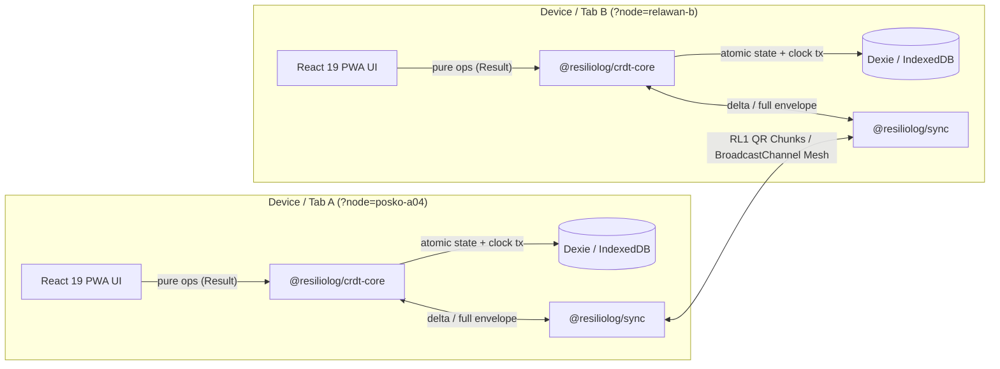

# ResilioLog

[](https://github.com/Lesmana24/ResilioLog/actions/workflows/ci.yml)

**Offline-first Progressive Web App (PWA) for disaster-relief logistics.**  
Field posts and volunteers record stock receipts, distributions, quota allocations, and audited emergency overrides completely offline in IndexedDB—then converge conflict-free across devices without any central server using state-based CvRDTs (**PN-Counter**, **OR-Set**) and a **Bounded Counter** to prevent quota overselling.

> **STACK 2026 (GDGoC ITB)** · Semifinal · Team **LET MI TING**

---

## 1. The Problem & Why Offline-First

During disasters, local logistics volunteers operate under intermittent or completely absent network connectivity. Paper logs and ad-hoc chat messages lead to lost records, duplicated distributions, and conflicting stock counts precisely when central servers are unreachable (Balcik et al., 2010).

ResilioLog eliminates the central server dependency:
- **Every device is a full replica:** Writes finish immediately against local IndexedDB with zero network latency.
- **Mathematically guaranteed convergence:** Merging two replicas is commutative, associative, and idempotent (Shapiro et al., 2011), so out-of-order, duplicated, or partitioned updates always reach the exact same state.
- **No silent overselling:** A **Bounded Counter** (Balegas et al., 2015) partitions distributable quota rights across nodes so offline posts cannot overspend global stock unless a volunteer explicitly invokes an audited **Emergency Quota Override**.

---

## 2. Capabilities (V1 Scope vs. Roadmap)

| Area | Implemented in V1 (`dev`) | Roadmap / Non-Goals |
|---|---|---|
| **Local Persistence** | Dexie (IndexedDB) storing `state` + Lamport `clock` atomically in one transaction; interactive `navigator.storage.persist()` elevation | Multi-tenant cloud DB / user accounts |
| **Offline PWA Shell** | Service Worker (`public/sw.js`) + `manifest.webmanifest` for offline `Ctrl+R` reload | — |
| **CRDT Engine** | Pure TypeScript `@resiliolog/crdt-core` (0 runtime deps): Lamport clocks, PN-Counter, OR-Set, Bounded Counter, `mergeStates` | Tombstone compaction / CRDT GC |
| **Quota & Overrides** | Local quota guard (`localRights >= qty`), automatic top-up trigger at `<= 15%`, mandatory-reason `Emergency Quota Override` visible in Command Center | Automated external procurement APIs |
| **Zero-Server Sync** | `@resiliolog/sync`: `fflate` deflate (level 9) + `base64url` + Zod schema + IEEE CRC-32 envelopes; chunked `RL1` QR frames (`ChunkCollector`); multi-tab `BroadcastChannel('resiliolog-mesh')` | Native BLE / Wi-Fi Direct background sync (D-004); signed/encrypted envelopes |

---

## 3. Architecture & Package Boundaries

ResilioLog is structured as a strict unidirectional `pnpm` monorepo (`crdt-core` ← `sync` ← `app`). No UI or I/O code lives inside `crdt-core`, and no merge/quota logic is re-implemented in the UI.



| Layer | Package | Allowed Imports | Responsibilities |
|---|---|---|---|
| **Engine** | `@resiliolog/crdt-core` | *None (0 runtime deps)* | Lamport timestamps, `canonicalize`, PN-Counter, OR-Set, Bounded Counter, `mergeStates`, item ops (`ops.ts`), `itemSummary` |
| **Wire** | `@resiliolog/sync` | `crdt-core`, `zod`, `fflate` | Locked Zod schemas (`docs/schema/schema.json`), `canonicalJson`, IEEE `crc32Hex`, `makeDelta` / `applyDelta`, envelope encode/decode, `RL1` QR chunking |
| **App** | `@resiliolog/app` | `crdt-core`, `sync`, React, Dexie, Tailwind v4, `qrcode.react`, `lucide-react` | 3 responsive screens, Dexie persistence (`kv`, `state`, `cursors`), multi-tab `?node=` isolation, QR frame export/import, Service Worker |

### Atomic Dexie Persistence (`packages/app/src/storage/db.ts`)
- **`kv`:** Persists the device's 8-character `[a-z0-9]` `nodeId` (generated once via `crypto.getRandomValues`) and ratified override IDs.
- **`state`:** Stores `nodeId`, Lamport `clock`, and `ResilioState` together inside a single `db.transaction('rw', db.state, ...)` after every operation or merge—preventing Lamport tag reuse on crash/reload.
- **`cursors`:** Local-only per-peer `until` clock & `lastSyncAt` metadata for delta sync.

---

## 4. CRDT & Bounded Counter Model

Every item in `ResilioState.items[itemId]` combines:
1. **PN-Counter (`ledger.p`, `ledger.n`):** Tracks cumulative receipts (`p[node]`) and distributions (`n[node]`) via pointwise `max` merge. Net stock = `sum(p) - sum(n)`.
2. **OR-Set (`distributionLog`, `topUpQueue`):** Observed-Remove Sets keyed by unique Lamport tags (`${nodeId}:${c}`). Voiding a log entry marks its tag in `removed` (display-only) without mutating stock or quota counters.
3. **Bounded Counter (`quota.R`, `quota.U`, `quota.O`):**
   - `R[i][i]` records rights added at node `i`; `R[i][j]` (`i != j`) records rights transferred from `i` to `j`.
   - `U[i]` records normal distributions; `O[i]` records emergency overrides.
   - **No-Overselling Invariant:** Normal `issue` is permitted iff `localRights(i) >= qty`. Otherwise it returns `err('INSUFFICIENT_RIGHTS')`.
   - **Auto Top-Up Trigger:** When an `issue` leaves `remainingRatio <= 0.15` (`TOP_UP_THRESHOLD`), a deduplicated `TopUpRequest` is enqueued in `topUpQueue`.
   - **Audited Emergency Override:** `emergencyIssue` requires a non-empty `reason` (3–200 chars; returns `REASON_REQUIRED` if missing), increments `O[i]`, and logs an `override_issue` entry that is never hidden in Command Center default views.
4. **Error-as-Value (`Result<T, ErrorCode>`):** Engine operations return `{ ok: true, value }` or `{ ok: false, error }` (`INVALID_QTY`, `INSUFFICIENT_RIGHTS`, `UNKNOWN_ITEM`, `SELF_TRANSFER`, `REASON_REQUIRED`, `SCHEMA_MISMATCH`) mapped to localized `EN` / `ID` UI messages.

---

## 5. Zero-Server Sync & Wire Protocol (`@resiliolog/sync`)

```text
Replica + peerCursor (0 if new peer)
  -> makeDelta(replica, since)
  -> buildEnvelope(replica, since, 'delta' | 'full', to?)   [computes IEEE crc32Hex of canonicalJson(payload)]
  -> encodeEnvelope(env)                                    [JSON -> fflate deflateSync(level 9) -> base64url]
  -> chunkBlob(blob, msgId, 800)                            [RL1|<msgId>|<i>/<n>|<slice>]
  -> [QR Display / BroadcastChannel / Frame Importer]
  -> ChunkCollector.add(chunk) ... until complete           [tolerates duplicates & out-of-order frames]
  -> collector.assemble()
  -> decodeEnvelope(blob)                                   [base64url -> inflateSync -> JSON -> Zod strict -> CRC-32 verify]
  -> applyDelta(localReplica, payload, envelope.until)      [mergeIntoReplica + advance clock]
```

Any corrupted frame, version mismatch, or invalid schema throws a typed `SyncError` (`BAD_ENCODING`, `BAD_COMPRESSION`, `BAD_JSON`, `SCHEMA_INVALID`, `CRC_MISMATCH`, `SCHEMA_VERSION_MISMATCH`, `INCOMPLETE_CHUNKS`) and leaves local state untouched.

---

## 6. PWA Screens (`@resiliolog/app`)

1. **Field Inventory (`Inventaris`):**
   - `Scan Crate` (1-click simulated crate barcode modal for demo reliability) & `Input Code` manual entry.
   - `+ Receive` / `- Issue` toggle (quota bar and `Emergency Quota Override` appear exclusively in `- Issue` mode).
   - Quantity stepper + `+5` / `+10` / `+20` presets, live `Remaining Quota` bar with `+ Request Quota` CTA at `<= 15%`, and filterable `Pending Local Logs` (`All` / `Receive` / `Issue` / `Override` + `Void`).
2. **P2P Sync:**
   - Live `Ready to Sync (Offline)` status card with Emerald (`#059669`) indicator, nearby peer tab counter, and verified stock tiles.
   - `Nearby P2P Sync` broadcasting compressed, Zod-validated envelopes over `BroadcastChannel('resiliolog-mesh')`.
   - `Courier Transfer (QR)` rendering chunked `<QRCodeSVG />` frames (`Prev` / `Next` / `Copy Frame`), `RL1` frame importer with `k of n` progress, and 1-click **Simulate Courier Arrival at Command Center**.
3. **Command Center (Desktop View):**
   - Interactive sidebar (`Map & Stock`, `Post Quota Allocation`, `CvRDT Convergence Log`, `Courier Fleet`).
   - Topographic SVG sector map with clickable post pins (`Posko A-04`, `Posko C-02`, and green `Posko B-07 185% Surplus`) opening inline stock & Bounded Counter detail cards.
   - Live search filtering across the audit table, urgent actions, convergence log, and quota cards; working `Export Log` JSON download, `Approve Reroute (+100 Quota)` (`transferRights` + `resolveTopUp`), and `Ratify Override Quota`.
4. **Bilingual & Persistent Storage Controls:**
   - Default **`EN`** UI with instant `ID | EN` toggle across all screens (24-hour `WIB` timestamps in `ID` mode).
   - Clickable storage persistence badge in the top demo bar + `"Enable Persistent Storage"` button in the storage warning banner.

---

## 7. Repository Layout & Tech Stack

```text
ResilioLog/
├── .github/workflows/ci.yml        # GitHub Actions CI: frozen-lockfile, typecheck, test
├── docs/                           # PRD, specs, locked JSON schema, API, claims, offline checklist
├── packages/
│   ├── crdt-core/                  # Pure CvRDT & Bounded Counter engine + property tests
│   ├── sync/                       # Wire format, Zod schemas, fflate, CRC-32, QR chunks + tests
│   └── app/                        # React 19 + Vite 8 + Tailwind v4 PWA + Dexie + SW + integration tests
├── package.json                    # Workspace root (pnpm@10.32.1, Node >= 20)
├── pnpm-workspace.yaml
└── tsconfig.base.json              # Strict TS (exactOptionalPropertyTypes, noUncheckedIndexedAccess)
```

**Core Stack:** TypeScript `^7.0.2` · React `^19.3.1` · Vite `^8.4.0` · Tailwind CSS `^4.3.5` · Dexie `^4.4.7` · `dexie-react-hooks` `^4.4.0` · `fflate` `^0.8.3` · Zod `^4.6.7` · `qrcode.react` `^4.2.0` · `lucide-react` `^1.81.0` · Vitest `^5.1.2` · `fast-check` `^4.11.0`.

---

## 8. Getting Started & Interactive Multi-Tab Demo

### Prerequisites
- **Node.js** `>= 20` (`.nvmrc` pins `22`)
- **pnpm** `10.x` (`corepack enable` if not installed globally)

### Commands
```bash
# Install dependencies across all workspace packages
pnpm install

# Typecheck all packages (crdt-core, sync, app)
pnpm typecheck

# Run all unit, property-based CRDT law, and integration tests
pnpm test

# Start the PWA dev server (http://localhost:5173)
pnpm --filter @resiliolog/app dev

# Build production PWA bundle (outputs packages/app/dist/ with sw.js & manifest.webmanifest)
pnpm --filter @resiliolog/app build
```

### Multi-Tab Offline Mesh Demo
1. Start the dev server: `pnpm --filter @resiliolog/app dev`
2. Open two isolated nodes in separate browser tabs (each gets its own IndexedDB database `resiliolog_<node>`):
   - **Tab 1 (Forward Post):** `http://localhost:5173/?node=posko-a04`
   - **Tab 2 (Field Peer):** `http://localhost:5173/?node=relawan-b`
3. In Tab 1 (**Inventory**), record an `- Issue` of `5` units of `Paket Sembako` (`15/100` → `10/100`), or test **Emergency Quota Override** with a reason.
4. Switch to **P2P Sync** in Tab 1 and click **Nearby P2P Sync**—Tab 2 automatically receives, inflates, Zod-validates, and merges the delta via `BroadcastChannel('resiliolog-mesh')`.
5. Switch the top demo bar to **Command Center**, click map pins to inspect live stock/rights, and click **Approve Reroute (+100 Quota)** to transfer quota from `Posko B-07` to `Posko A-04`.
6. Toggle browser DevTools **Offline** mode and press `Ctrl+R`—the Service Worker (`public/sw.js`) serves the cached app shell while IndexedDB preserves all state and Lamport clocks.

---

## 9. Verification & Measured Evidence

Observed outputs on branch `dev` (`pnpm typecheck && pnpm test && pnpm --filter @resiliolog/app build`):

| Check / Package | Scope | Observed Result |
|---|---|---|
| `pnpm typecheck` | `@resiliolog/crdt-core`, `@resiliolog/sync`, `@resiliolog/app` | **Exit code 0** (strict TS) |
| `@resiliolog/crdt-core` | 8 test files (L1–L3 laws, Bounded Counter B1–B5, C1 convergence, `canonicalize`) | **44 tests passed** |
| `@resiliolog/sync` | 6 test files (`schema.json` validation, CRC-32, deflate, QR chunks, 3-replica wire C1) | **15 tests passed** |
| `@resiliolog/app` | 1 integration test file (`test/app-integration.test.ts` against real `crdt-core` & `sync`) | **6 tests passed** |
| `pnpm --filter @resiliolog/app build` | Production Vite 8 + Tailwind v4 bundle + PWA assets (`manifest.webmanifest`, `sw.js`, `icon.svg`) | **Exit code 0** |

**Measured QR Wire Sizes** (`packages/sync/test/size-report.test.ts` — W8):
- Small dataset (3 items, 10 ops): `698` chars → **1 QR chunk**
- Medium dataset (10 items, 60 ops): `1611` chars → **3 QR chunks**
- Large dataset (20 items, 200 ops): `3414` chars → **5 QR chunks**

---

## 10. Security & Privacy Notes (V1)

- V1 performs no user authentication and does not sign or encrypt sync envelopes; payloads contain only inventory item metadata, numeric counters, Lamport timestamps, and optional volunteer-entered `counterparty` / `note` / `reason` strings.
- Signed envelopes and per-node cryptographic keys are planned post-V1 (`docs/ARCHITECTURE.md` §11).

---

## 11. Documentation Index

- [docs/PRD.md](docs/PRD.md) — product scope, user stories, acceptance criteria
- [docs/TECH-STACK.md](docs/TECH-STACK.md) — stack rationale, platform constraints, dependency budget
- [docs/STRUCTURE.md](docs/STRUCTURE.md) — repository layout and dependency direction
- [docs/SETUP.md](docs/SETUP.md) — environment setup, phone/HTTPS testing, troubleshooting
- [docs/ARCHITECTURE.md](docs/ARCHITECTURE.md) — layers, Dexie persistence, wire protocol, QR chunking
- [docs/SPEC-CRDT.md](docs/SPEC-CRDT.md) — formal CRDT definitions and merge semantics
- [docs/API.md](docs/API.md) — public API contract for `@resiliolog/crdt-core` and `@resiliolog/sync`
- [docs/schema/schema.json](docs/schema/schema.json) — locked wire/state contract (JSON Schema 2020-12)
- [docs/UI-CONTRACT.md](docs/UI-CONTRACT.md) — screens, engine calls, error-to-message mapping
- [docs/TEST-PLAN.md](docs/TEST-PLAN.md) — property-based laws, invariants, and test gates
- [docs/EMERGENCY-OVERRIDE.md](docs/EMERGENCY-OVERRIDE.md) — medical override and audit rules
- [docs/OFFLINE-CHECK.md](docs/OFFLINE-CHECK.md) — offline PWA verification checklist
- [docs/CLAIMS.md](docs/CLAIMS.md) — evidence-backed claims and citations
- [docs/DECISIONS.md](docs/DECISIONS.md) — architecture decision log
- [docs/RISKS.md](docs/RISKS.md) — risk register and mitigations

---

## 12. References

- Shapiro, M., Preguiça, N., Baquero, C., & Zawirski, M. (2011). *Conflict-free Replicated Data Types*. SSS 2011 / INRIA RR-7506.
- Balegas, V., Duarte, S., Ferreira, C., Rodrigues, R., Preguiça, N., Najafzadeh, M., & Shapiro, M. (2015). *Extending Eventually Consistent Cloud Databases for Enforcing Numeric Invariants*. SRDS 2015.
- Balcik, B., Beamon, B. M., Krejci, C. C., Muramatsu, K. M., & Ramirez, M. (2010). *Coordination in humanitarian relief chains: Practices, challenges and opportunities*. International Journal of Production Economics, 126(1).
