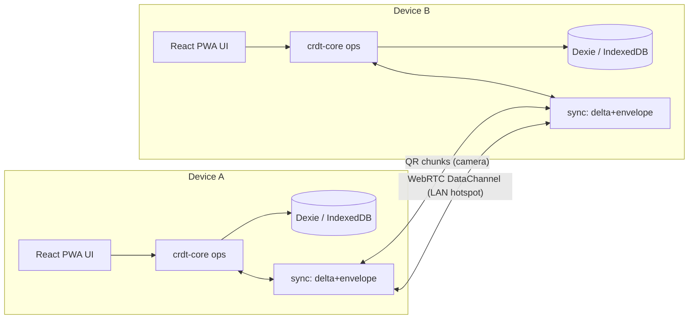

# ARCHITECTURE — ResilioLog V1

## 1. Overview

No server is required for any V1 function. Every device is a full replica.

## 2. Layers and rules
| Layer | Package | Allowed imports | Contains |
|---|---|---|---|
| Engine | `crdt-core` | none | types, Lamport, PN, OR-Set, Bounded, merge, item ops |
| Sync | `sync` | `crdt-core` | delta cut/apply, envelope, crc32, deflate+base64url, QR chunking, Zod validation |
| App | `app` | `crdt-core`, `sync` | UI, Dexie persistence, QR scan/render, WebRTC, service worker |

Data flow for a user action: UI → `crdt-core` op (pure, returns new Replica) → persist Replica (one Dexie transaction) → re-render from state.
Data flow for sync: `makeDelta(replica, peerCursor)` → envelope → encode → QR/WebRTC → decode → validate (Zod + crc32) → `mergeIntoReplica` → persist → advance cursor.

## 3. Replica identity and clock
- `nodeId`: 8 random chars `[a-z0-9]`, generated on first launch (app layer may use `crypto.getRandomValues`; core never does). Persisted; never regenerated. Clearing site data = new identity (acceptable; old identity's data survives on peers).
- `clock`: Lamport counter, persisted with state in the same transaction. Losing it is dangerous (tag reuse) → always write state and clock together.

## 4. Persistence (Dexie, app layer)
| Table | Key | Value |
|---|---|---|
| `kv` | `'nodeId'` / `'clock'` | string / number |
| `state` | `'main'` | `ResilioState` JSON |
| `cursors` | peer `nodeId` | `number` (last Lamport `until` we sent to / acknowledged for that peer) |
V1 stores one state document (small data). Cursors are local-only and never synced. Persist after every operation and after every merge.

## 5. Delta selection (item-granular)
`makeDelta(replica, sinceCursor)`:
- items where `touchedAt.c > since` → include the **whole** ItemState (counters are small),
- log/queue entries whose tag counter `> since` → include (and their `removed` tags),
- `until = replica.clock`.
Receiver merges payload with `mergeStates`. Because merge is idempotent, over-inclusion is safe; losing a cursor only costs bandwidth (fall back to `since = 0`, i.e. full state).
Gossip works naturally: items learned from A are included in later deltas to B because `touchedAt` is max-merged (counter may exceed B's cursor).
Edge: for a brand-new peer use `type: "full"`, `since: 0`.

## 6. Wire format
1. Build `SyncEnvelope` (see `schema/schema.json`).
2. `crc32` = CRC-32 of canonical JSON of `payload` (sorted keys, no whitespace).
3. `blob = base64url( deflate( UTF8( JSON(envelope) ) ) )` (fflate `deflateSync`, level 9).
4. Receiver: base64url decode → inflate → JSON parse → Zod validate → verify `crc32` → merge. Any failure → reject with a typed error, state untouched.

### QR chunking
- Chunk string: `RL1|<msgId>|<i>/<n>|<slice>`, `i` 1-based, default slice **800** chars, QR error correction **M**.
- Display chunks as an auto-cycling sequence (≈ 2–3 per second) or swipeable; scanner collects by `msgId`, tolerates **duplicates and any order**, shows "k of n scanned", completes when all `n` present.
- Different `msgId` mid-scan → start a new collection (discard old).
- V1 must work for deltas up to ≈ 20 chunks. Larger → show message "use full-file/WebRTC".
- **Measure, do not guess:** B-11 includes a test that logs blob size for realistic data (e.g., 20 items, 200 log entries). Only claim sizes that were measured (CLAIMS.md).

## 7. WebRTC local sync (P1)
- `RTCPeerConnection({ iceServers: [] })` — host candidates only; works when both phones are on the same hotspot/LAN.
- **Manual signaling**: offer → shown as QR (chunked, same chunk format, `SignalEnvelope`) → peer scans → answer shown as QR → first device scans. Wait for ICE gathering to complete before encoding SDP (non-trickle).
- One DataChannel `sync`. Messages are JSON strings of `SyncEnvelope`; split above 16 KB.
- Fallback if WebRTC fails on a network (client isolation, etc.): QR path. Never make WebRTC a hard dependency for the demo.
- Known risk: some hotspots/AP isolation block peer traffic → test early on the actual demo devices.

## 8. Error handling
Typed errors from `sync`: `BAD_ENCODING`, `BAD_COMPRESSION`, `BAD_JSON`, `SCHEMA_INVALID`, `CRC_MISMATCH`, `SCHEMA_VERSION_MISMATCH`, `INCOMPLETE_CHUNKS`. The UI shows a human message and never partially applies data.

## 9. Versioning
`schemaVersion = 1`. A receiver with a different version rejects the message (`SCHEMA_VERSION_MISMATCH`). No migrations in V1.

## 10. Delivery and secure context
Camera scanning and the service worker require HTTPS (or localhost). The PWA is built statically and hosted on an HTTPS static host (or served with dev HTTPS), loaded and installed once online, then runs fully offline. See TECH-STACK §7–8 and SETUP §5.

## 11. Security/Privacy notes (V1, state honestly in proposal)
No authentication or encryption in V1; payloads contain no personal data beyond free-text counterparty/notes entered by volunteers. Planned: signed envelopes, per-node keys.
